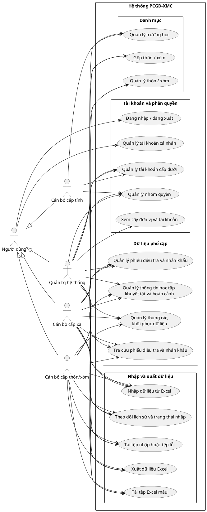

# TÀI LIỆU PHÂN TÍCH YÊU CẦU PHẦN MỀM (SRS)
**Dự án:** Hệ thống Quản lý Phổ cập Giáo dục & Xóa mù chữ (PCGD-XMC)  
**Phạm vi:** Quản lý Địa giới, Hộ gia đình, Nhân khẩu & Xử lý Excel Import/Export  

---

## I. TỔNG QUAN DỰ ÁN (PROJECT OVERVIEW)

### 1. Mục tiêu hệ thống
Hệ thống được xây dựng nhằm số hóa quy trình quản lý thông tin hộ gia đình, nhân khẩu trong độ tuổi phổ cập giáo dục, theo dõi quá trình học tập/biến động nhân khẩu cấp Xã/Phường, và cung cấp công cụ **Import/Export Excel dung lượng lớn** ổn định, chính xác.

### 2. Phạm vi hệ thống (System Scope)
* **In-Scope (Các mảng thực hiện):**
  * Quản lý Địa giới hành chính & Danh mục hệ thống.
  * Quản lý Hộ gia đình và Nhân khẩu trong độ tuổi PCGD.
  * Quản lý Quá trình học tập & Trình độ học vấn của từng cá nhân.
  * Quản lý Biến động nhân khẩu (Chuyển đi, chuyển đến, đi làm xa, qua đời).
  * Xử lý Async Import/Export Excel dữ liệu quy mô lớn (Background Queues).
  * Phân quyền người dùng dựa trên phạm vi địa lý (RBAC).
* **Out-of-Scope (Không thực hiện):**
  * Tổng hợp chỉ số thống kê & Tính toán tỷ lệ đạt chuẩn công nhận PCGD-XMC.
  * Kết xuất các mẫu biểu báo cáo thống kê phức tạp gửi Sở/Bộ GD&ĐT.

---

## II. XÁC ĐỊNH CÁC TÁC NHÂN (ACTORS & ROLES)

| STT | Tác nhân (Actor) | Mô tả vai trò & Quyền hạn |
| :--- | :--- | :--- |
| **1** | **System Admin** | Quản trị toàn hệ thống: Quản lý tài khoản, cấu hình tham số, phân quyền và giám sát hệ thống. |
| **2** | **Cán bộ PCGD cấp Xã/Phường** | Nhập liệu chính: Quản lý toàn bộ Hộ gia đình/Nhân khẩu thuộc địa bàn quản lý, thực hiện Import/Export Excel. |
| **3** | **Cán bộ Điều tra (CTV/Giáo viên)** | Thu thập dữ liệu thực địa: Tra cứu, cập nhật thông tin nhân khẩu/học tập theo Thôn/Xóm được phân công. |

### Sơ đồ Use Case tổng quan

Sơ đồ dưới đây mô tả các nhóm chức năng chính theo ứng dụng hiện tại. Các cán bộ địa bàn là những người dùng được cấp phạm vi và quyền tương ứng; việc một tác nhân có thể thực hiện chức năng nào còn phụ thuộc vào quyền được gán và địa bàn quản lý. Quản trị hệ thống có quyền nghiệp vụ toàn hệ thống.

**Lưu ý khi sử dụng sơ đồ:**

- Có thể render khối mã PlantUML bằng tiện ích hỗ trợ PlantUML trong VS Code hoặc PlantUML server nội bộ.
- `Người dùng cấp tỉnh/xã/thôn` là tác nhân theo phạm vi địa lý; không đồng nghĩa mọi tài khoản trong cùng cấp đều có toàn bộ quyền được nối trong sơ đồ.
- Queue xử lý import là thành phần nội bộ của hệ thống, không phải tác nhân bên ngoài nên không biểu diễn như actor.
- Chưa đưa các chức năng tính tỷ lệ PCGD-XMC, phê duyệt liên cấp, biến động nhân khẩu độc lập hoặc báo cáo gửi Sở/Bộ vào sơ đồ vì chưa được xác nhận là chức năng hiện có.

---

## III. YÊU CẦU CHỨC NĂNG CHI TIẾT (FUNCTIONAL REQUIREMENTS)

### 1. Quản lý Danh mục & Địa giới hành chính (Category Management)
* **UC-01: Quản lý Cây địa giới hành chính:**
  * Cấu hình phân cấp địa giới 4 cấp: `Tỉnh/Thành phố` -> `Quận/Huyện` -> `Xã/Phường` -> `Thôn/Xóm/Tổ dân phố`.
* **UC-02: Quản lý Danh mục dùng chung:**
  * Thêm/sửa/xóa/đóng các danh mục: Trường học, Dân tộc, Quan hệ gia đình, Mức độ khuyết tật, Lý do bỏ học, Loại hộ kinh tế (Nghèo/Cận nghèo/Thường).

### 2. Quản lý Hộ gia đình & Nhân khẩu (Household & Demographic Management)
* **UC-03: Quản lý Hộ gia đình (CRUD):**
  * Thêm mới, cập nhật, xóa, tra cứu Hộ gia đình.
  * Thuộc tính bắt buộc: Mã hộ, Họ tên chủ hộ, Số điện thoại, Thôn/Xóm, Phân loại kinh tế.
* **UC-04: Quản lý Nhân khẩu / Đối tượng PCGD (CRUD):**
  * Thêm mới, chỉnh sửa, tra cứu thông tin nhân khẩu thuộc Hộ gia đình.
  * Thông tin định danh: Họ tên, Ngày/tháng/năm sinh, Giới tính, Mã định danh/CCCD, Dân tộc, Tình trạng khuyết tật/Hòa nhập.
* **UC-05: Quản lý Quá trình học tập & Trình độ học vấn:**
  * Cập nhật trạng thái học tập: *Đang đi học, Đã tốt nghiệp, Bỏ học, Chưa từng đi học*.
  * Cập nhật trình độ hiện tại: *Mầm non, Tiểu học, THCS, THPT, Xóa mù chữ (Mức 1, Mức 2)*.
  * Lưu trữ thông tin: Tên trường đang học/đã tốt nghiệp, Năm tốt nghiệp, Lý do bỏ học (nếu có).
* **UC-06: Quản lý Biến động nhân khẩu:**
  * Ghi nhận lịch sử biến động: *Chuyển đi nơi khác, Chuyển đến, Đi làm xa, Đã mất*.
  * Cập nhật trạng thái hiển thị của nhân khẩu trên địa bàn mà không làm mất lịch sử dữ liệu (Soft Delete / Status Change).

### 3. Quản lý Import/Export Excel & Validate Dữ liệu (Bulk Data Processing)
* **UC-07: Download File Excel Template Standard:**
  * Hệ thống xuất file `.xlsx` mẫu chứa định dạng chuẩn.
  * Tích hợp **Data Validation Rules (Dropdown list/VBA)** cho các cột danh mục (Thôn/Xóm, Giới tính, Trình độ...) để tránh người dùng gõ sai văn bản.
* **UC-08: Import Dữ liệu Nhân khẩu / Hộ gia đình từ Excel:**
  * Upload file Excel dữ liệu (1.000 – 50.000 dòng).
  * **Validation Engine (Kiểm tra trước khi lưu):**
    * Check rỗng các trường Bắt buộc (*Required fields*).
    * Check sai định dạng ngày sinh (`DD/MM/YYYY`).
    * Check trùng lặp số CCCD/Mã định danh trong hệ thống.
    * Check tính hợp lệ của cây Địa giới (Thôn/Xóm phải thuộc Xã/Phường đang thao tác).
  * **Asynchronous Queue Processing:** Đẩy công việc đọc file vào Background Queue (Redis Queue / Laravel Queue) để không làm đơ/timeout request giao diện.
  * **Error Log Reporting:** Nếu file chứa lỗi, hệ thống xuất trả lại file Excel ghi rõ lỗi tại đúng từng dòng/cột để cán bộ sửa và re-import.
* **UC-09: Export Dữ liệu Nhân khẩu ra Excel:**
  * Cho phép lọc (Filter) theo Thôn/Xóm, độ tuổi (vd: 6 tuổi, 15-18 tuổi), trạng thái học tập.
  * Xuất dữ liệu đã lọc ra file Excel thô để cán bộ lưu trữ nội bộ.

---

## IV. YÊU CẦU PHI CHỨC NĂNG (NON-FUNCTIONAL REQUIREMENTS)

### 1. Hiệu năng hệ thống (Performance)
* **Xử lý Excel:** Thời gian phản hồi UI khi upload file Excel < 3 giây (đưa ngay job vào Queue). Tiến trình ngầm xử lý 10.000 dòng không quá 2 phút.
* **Truy vấn dữ liệu:** Đảm bảo thời gian load trang danh sách nhân khẩu < 1.5 giây với CSDL trên 1.000.000 bản ghi (Yêu cầu đánh **Index B-Tree** tối ưu trên `ward_id`, `hamlet_id`, `identity_card`, `birth_date`).

### 2. Tính toàn vẹn & Ràng buộc dữ liệu (Data Integrity & Constraints)
* Tính toán tuổi tự động chính xác theo Năm điều tra (`Tuổi = Năm điều tra - Năm sinh`).
* Ràng buộc logic nghiệp vụ: Không thể cập nhật trình độ "Tốt nghiệp THCS" nếu chưa chọn hoàn thành "Tiểu học".
* Một Nhân khẩu bắt buộc phải thuộc duy nhất 1 Hộ gia đình tại một thời điểm.

### 3. Bảo mật & Phân quyền dữ liệu (Security & Authorization)
* Khai thác mô hình **Data-level Authorization**: Cán bộ thuộc Xã A chỉ có quyền xem, chỉnh sửa, import/export dữ liệu thuộc phạm vi Xã A; tuyệt đối không thể can thiệp dữ liệu Xã B.
* Mã hóa mật khẩu người dùng (Bcrypt / Argon2) và bảo mật các trường thông tin nhạy cảm.

---

## V. MA TRẬN PHÂN QUYỀN (USE CASE VS ACTOR MATRIX)

| Mã Use Case | Tên Use Case | System Admin | Cán bộ PCGD cấp Xã | Cán bộ Điều tra |
| :--- | :--- | :---: | :---: | :---: |
| **UC-01, 02** | Quản lý Địa giới & Danh mục | **X** | Chỉ xem | Chỉ xem |
| **UC-03** | CRUD Hộ gia đình | **X** | **X** | Chỉ xem |
| **UC-04, 05** | CRUD Nhân khẩu & Học tập | **X** | **X** | **X** (phân công) |
| **UC-06** | Cập nhật Biến động nhân khẩu | **X** | **X** | **X** |
| **UC-07, 08, 09**| Import / Export Excel | **X** | **X** | không |