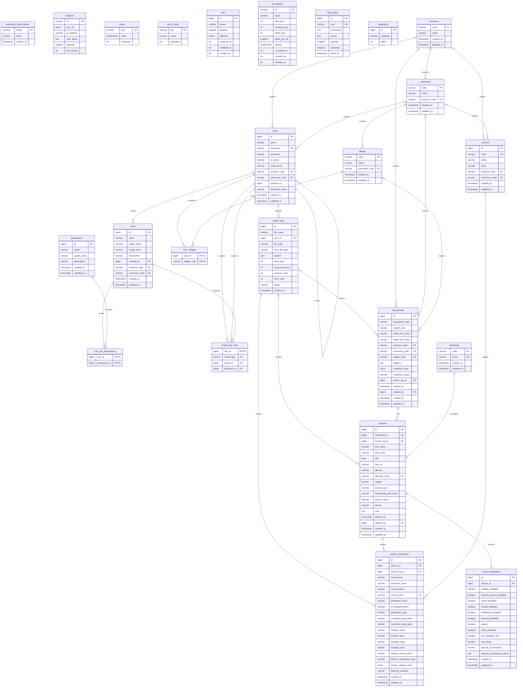

# Sơ đồ cơ sở dữ liệu PCGD

Sơ đồ Mermaid dưới đây mô tả các bảng nghiệp vụ, phân quyền và các bảng hạ tầng Laravel đang được dự án sử dụng.

## Ràng buộc và lưu ý

- `households` có unique constraint trên cặp `(school_year, household_code)`.
- `person_educations` có unique constraint trên cặp `(person_id, school_year)`.
- `roles` có unique constraint trên `(created_by, name, guard_name)`.
- `permissions` có unique constraint trên `(name, guard_name)`.
- `role_has_permissions` là bảng nối nhiều-nhiều giữa `roles` và `permissions`.
- `model_has_roles` là bảng gán role polymorphic: `model_id` kết hợp với `model_type` xác định model nhận role; `assigned_by` lưu người cấp.
- `user_villages` là bảng nối nhiều-nhiều giữa tài khoản và thôn/xóm.
- Trigger `persons_one_head_before_insert` và `persons_one_head_before_update` đảm bảo mỗi hộ tối đa một nhân khẩu có `relationship_with_head = 'Chủ hộ'`.
- Phiếu/hộ và nhân khẩu dùng xóa mềm; `deleted_at` lưu thời điểm xóa, `deleted_by` lưu tài khoản thực hiện.
- Xóa vĩnh viễn hộ sẽ xóa nhân khẩu liên quan; xóa vĩnh viễn nhân khẩu sẽ xóa dữ liệu học tập và khuyết tật.
- Trigger chủ hộ chỉ xét nhân khẩu chưa bị xóa mềm; khôi phục chủ hộ sẽ bị từ chối nếu hộ đã có chủ hộ khác.
- Xóa `import_logs` đặt `import_log_id` của các bản ghi nhập liên quan thành `NULL`.
- `sessions.user_id` được đánh index nhưng không có foreign key trong migration Laravel.
- `model_has_roles.model_id` và `model_type` không có foreign key vì đây là quan hệ polymorphic.
- Bảng `model_has_permissions` không còn được sử dụng; migration ngày `2026-10-12` đã xóa bảng này.
- Trường phân quyền `users.created_by` được ứng dụng và kiểm thử sử dụng. Hãy đối chiếu cột này với schema đang chạy nếu môi trường chưa áp dụng migration tạo cột.
