# Sơ đồ cơ sở dữ liệu PCGD

Sơ đồ Mermaid dưới đây mô tả các bảng trong cơ sở dữ liệu PCGD hiện tại, gồm bảng nghiệp vụ, phân quyền và các bảng hạ tầng Laravel. Các cơ sở dữ liệu khác trên cùng máy chủ không thuộc sơ đồ này.

```mermaid
erDiagram
    users {
        bigint id PK
        varchar name
        varchar username UK
        varchar phone
        varchar citizen_id UK
        date date_of_birth
        varchar email UK
        varchar password
        boolean is_active
        varchar scope_level
        varchar province_code FK
        varchar commune_code FK
        bigint created_by FK
        varchar remember_token
        timestamp created_at
        timestamp updated_at
    }

    password_reset_tokens {
        varchar email PK
        varchar token
        timestamp created_at
    }

    sessions {
        varchar id PK
        bigint user_id
        varchar ip_address
        text user_agent
        longtext payload
        int last_activity
    }

    personal_access_tokens {
        bigint id PK
        varchar tokenable_type
        bigint tokenable_id
        text name
        varchar token UK
        text abilities
        timestamp last_used_at
        timestamp expires_at
        timestamp created_at
        timestamp updated_at
    }

    cache {
        varchar key PK
        mediumtext value
        int expiration
    }

    cache_locks {
        varchar key PK
        varchar owner
        int expiration
    }

    jobs {
        bigint id PK
        varchar queue
        longtext payload
        tinyint attempts
        int reserved_at
        int available_at
        int created_at
    }

    job_batches {
        varchar id PK
        varchar name
        int total_jobs
        int pending_jobs
        int failed_jobs
        longtext failed_job_ids
        mediumtext options
        int cancelled_at
        int created_at
        int finished_at
    }

    failed_jobs {
        bigint id PK
        varchar uuid UK
        text connection
        text queue
        longtext payload
        longtext exception
        timestamp failed_at
    }

    migrations {
        bigint id PK
        varchar migration
        int batch
    }

    roles {
        bigint id PK
        varchar name
        varchar guard_name
        varchar scope_level
        varchar description
        bigint created_by FK
        varchar province_code FK
        varchar commune_code FK
        timestamp created_at
        timestamp updated_at
    }

    permissions {
        bigint id PK
        varchar name
        varchar guard_name
        varchar description
        timestamp created_at
        timestamp updated_at
    }

    role_has_permissions {
        bigint role_id PK, FK
        bigint permission_id PK, FK
    }

    model_has_roles {
        bigint role_id PK, FK
        varchar model_type PK
        bigint model_id PK
        bigint assigned_by FK
    }

    user_villages {
        bigint user_id PK, FK
        varchar village_code PK, FK
    }

    import_logs {
        bigint id PK
        varchar file_name
        bigint user_id FK
        varchar file_path
        varchar error_file_path
        json context
        int total_rows
        int processed_rows
        int success_rows
        int error_rows
        varchar status
        timestamp created_at
        timestamp notification_read_at
    }

    provinces {
        varchar code PK
        varchar name
        timestamp created_at
        timestamp updated_at
    }

    communes {
        varchar code PK
        varchar name
        varchar province_code FK
        timestamp created_at
        timestamp updated_at
    }

    villages {
        varchar code PK
        varchar name
        varchar commune_code FK
        timestamp intake_paused_at
        bigint intake_paused_by FK
        varchar merged_into_code FK
        timestamp merged_at
        timestamp created_at
        timestamp updated_at
    }

    schools {
        bigint id PK
        varchar code UK
        varchar name
        varchar type "single_level | multi_level"
        varchar level
        varchar province_code FK
        varchar commune_code FK
        timestamp deleted_at
        timestamp created_at
        timestamp updated_at
    }

    school_merge_histories {
        bigint id PK
        varchar province_code
        varchar commune_code
        json source_codes
        json source_names
        varchar target_code
        varchar target_name
        varchar qd_sap_nhap
        bigint merged_by FK
        timestamp created_at
        timestamp updated_at
    }

    village_merge_histories {
        bigint id PK
        varchar commune_code
        json source_codes
        json source_names
        varchar target_code
        varchar target_name
        varchar reason
        bigint merged_by FK
        timestamp created_at
        timestamp updated_at
    }

    ethnicities {
        varchar code PK
        varchar name UK
        timestamp created_at
        timestamp updated_at
    }

    households {
        bigint id PK
        varchar household_code
        varchar school_year
        varchar head_first_name
        varchar head_last_name
        varchar province_code FK
        varchar commune_code FK
        varchar village_code FK
        text address
        enum residence_type
        varchar residence_status
        bigint import_log_id FK
        timestamp deleted_at
        bigint deleted_by FK
        timestamp created_at
        timestamp updated_at
    }

    persons {
        bigint id PK
        bigint household_id FK
        bigint import_log_id FK
        varchar first_name
        varchar last_name
        date dob
        varchar dob_str
        enum gender
        varchar ethnicity_code FK
        varchar ethnicity
        varchar religion
        varchar priority_type
        varchar relationship_with_head
        varchar parent_name
        varchar phone
        text note
        timestamp deleted_at
        bigint deleted_by FK
        timestamp created_at
        timestamp updated_at
    }

    person_educations {
        bigint id PK
        bigint person_id FK
        bigint import_log_id FK
        varchar school_year
        varchar academic_block
        varchar current_class
        varchar school_code
        varchar graduation_level
        boolean is_complementary
        varchar graduation_year
        varchar vocational_grad_level
        varchar vocational_grad_year
        varchar finished_class
        varchar finished_year
        varchar dropped_class
        varchar dropped_year
        varchar completed_class
        varchar literacy_current_class
        varchar literacy_completed_class
        varchar literacy_relapse_level
        varchar learning_capacity
        timestamp created_at
        timestamp updated_at
    }

    person_disabilities {
        bigint id PK
        bigint person_id FK
        boolean mobility_disability
        boolean hearing_speech_disability
        boolean visual_disability
        boolean mental_disability
        boolean intellectual_disability
        boolean learning_disability
        boolean autism
        boolean other_disability
        boolean has_disability_cert
        boolean can_study
        varchar special_circumstance
        text special_circumstance_detail
        timestamp created_at
        timestamp updated_at
    }

    users ||--o{ users : creates
    users o|--o{ villages : pauses intake at
    users ||--o{ roles : creates
    users ||--o{ model_has_roles : assigns
    users ||--o{ model_has_roles : receives
    users ||--o{ import_logs : uploads
    users ||--o{ user_villages : assigned
    users ||--o{ school_merge_histories : merges
    users ||--o{ village_merge_histories : merges

    roles ||--o{ role_has_permissions : grants
    permissions ||--o{ role_has_permissions : included
    roles ||--o{ model_has_roles : assigned

    provinces ||--o{ communes : contains
    communes ||--o{ villages : contains
    provinces o|--o{ schools : locates
    communes o|--o{ schools : locates
    provinces o|--o{ users : scopes
    communes o|--o{ users : scopes
    villages ||--o{ user_villages : assigned

    import_logs o|--o{ households : imports
    import_logs o|--o{ persons : imports
    import_logs o|--o{ person_educations : imports

    provinces o|--o{ households : locates
    communes o|--o{ households : locates
    villages o|--o{ households : locates
    households ||--o{ persons : has
    ethnicities o|--o{ persons : classifies
    persons ||--o{ person_educations : studies
    persons ||--o| person_disabilities : records
```

## Ràng buộc và lưu ý

- `households` có unique constraint trên cặp `(school_year, household_code)`.
- `person_educations` có unique constraint trên cặp `(person_id, school_year)`.
- `roles` có unique constraint trên `(created_by, name, guard_name)`.
- `permissions` có unique constraint trên `(name, guard_name)`.
- `role_has_permissions` là bảng nối nhiều-nhiều giữa `roles` và `permissions`.
- `model_has_roles` là bảng gán role polymorphic: `model_id` kết hợp với `model_type` xác định model nhận role; `assigned_by` lưu người cấp.
- `users.scope_level` và `roles.scope_level` chỉ nhận các cấp nghiệp vụ `global`, `province`, `commune`; giới hạn thôn của tài khoản cấp xã được lưu riêng trong `user_villages`.
- `user_villages` là bảng nối nhiều-nhiều giữa tài khoản cấp xã và các thôn/xóm được giao; danh sách này chỉ giới hạn tài khoản có quyền phiếu điều tra/nhân khẩu, nhập/xuất hoặc thùng rác. Nhóm quản lý thôn/xóm và nhóm không có các quyền đó áp dụng toàn xã; danh sách trống cũng nghĩa là toàn xã.
- `villages.intake_paused_at` và `intake_paused_by` lưu trạng thái tạm dừng nhận phiếu; `merged_into_code` và `merged_at` lưu thôn đích và thời điểm gộp. Thôn nguồn vẫn được giữ lại để tra cứu.
- Khi thôn tạm dừng, thao tác tạo/sửa/xóa phiếu và nhân khẩu, khôi phục/xóa vĩnh viễn trong thùng rác, cùng import phiếu đều bị khóa. Chỉ có thể gộp thôn sau khi các thôn nguồn đã tạm dừng và không còn import đang chờ/xử lý.
- `personal_access_tokens` lưu token theo quan hệ polymorphic `tokenable_type`/`tokenable_id`; không có khóa ngoại đến `users`.
- `school_merge_histories` và `village_merge_histories` lưu thông tin các lần gộp; chỉ `merged_by` có khóa ngoại đến `users`. Các mã tỉnh/xã/thôn/trường và mã nguồn/đích trong bảng lịch sử không được ràng buộc bằng khóa ngoại.
- `person_educations.school_code` có chỉ mục nhưng không có khóa ngoại đến `schools`.
- `persons.ethnicity` vẫn còn trong cơ sở dữ liệu bên cạnh `ethnicity_code`.
- Trigger `persons_one_head_before_insert` và `persons_one_head_before_update` đảm bảo mỗi hộ tối đa một nhân khẩu có `relationship_with_head = 'Chủ hộ'`.
- Phiếu/hộ và nhân khẩu dùng xóa mềm; `deleted_at` lưu thời điểm xóa, `deleted_by` lưu tài khoản thực hiện.
- Xóa vĩnh viễn hộ sẽ xóa nhân khẩu liên quan; xóa vĩnh viễn nhân khẩu sẽ xóa dữ liệu học tập và khuyết tật.
- Trigger chủ hộ chỉ xét nhân khẩu chưa bị xóa mềm; khôi phục chủ hộ sẽ bị từ chối nếu hộ đã có chủ hộ khác.
- Xóa `import_logs` đặt `import_log_id` của các bản ghi nhập liên quan thành `NULL`.
- `sessions.user_id` được đánh index nhưng không có foreign key trong migration Laravel.
- `model_has_roles.model_id` và `model_type` không có foreign key vì đây là quan hệ polymorphic.
- Bảng `model_has_permissions` không còn được sử dụng; migration ngày `2026-10-12` đã xóa bảng này.
- Bảng `api_token_sessions` không có trong cơ sở dữ liệu hiện tại.
